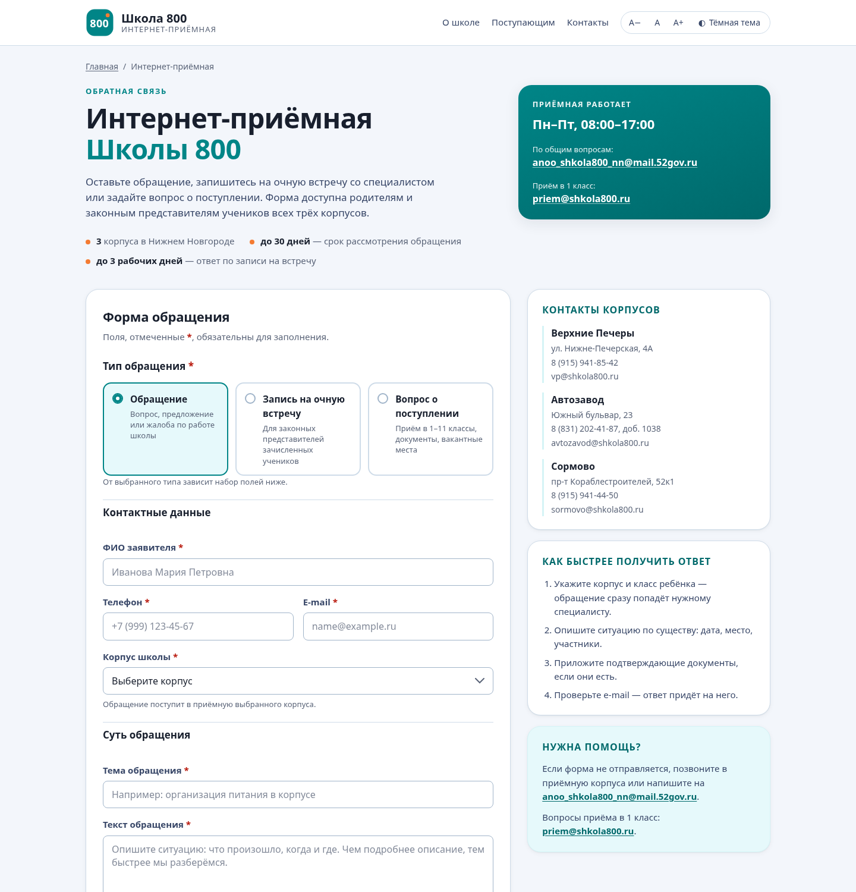
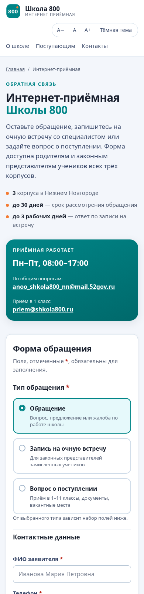

# Интернет-приёмная «Школа 800»

Веб-форма обратной связи для сайта [АНОО «Школа 800»](https://shkola800.ru/) (Нижний Новгород).
Одна страница с тремя сценариями обращения — как в действующей интернет-приёмной школы,
но с единой валидацией на клиенте и сервере, загрузкой документов и доступным интерфейсом.



<p align="center">
  
</p>

## Что умеет

**Три типа обращения** — переключатель меняет набор полей:

| Тип | Дополнительные поля |
| --- | --- |
| Обращение | тема, текст обращения, вложения |
| Запись на очную встречу | класс ребёнка, дата и время (будни, 09:00–17:00), вопрос |
| Вопрос о поступлении | ФИО и дата рождения ребёнка, класс поступления |

**Форма и UX**

- общие для браузера и сервера правила валидации (`shared/validation.mjs`);
- маска телефона `+7 (999) 123-45-67`, нормализация в `+7XXXXXXXXXX`;
- ошибки у каждого поля, сводка ошибок с переходом к первому проблемному полю, `aria-invalid`;
- загрузка файлов мышью (drag&drop) и с клавиатуры: до 5 файлов, до 5 МБ суммарно, PDF/JPG/PNG/DOC/DOCX/TXT;
- счётчик символов, автосохранение черновика в `localStorage`;
- панель доступности: три шага размера шрифта и светлая/тёмная тема (запоминаются);
- адаптивная вёрстка, `prefers-reduced-motion`, корректная работа скринридеров;
- успешный ответ показывает номер обращения и позволяет отправить следующее;
- работает и без JavaScript для типа «Обращение» (обычный POST с редиректом).

**Сервер**

- без внешних зависимостей: `node:http`, Node.js ≥ 20;
- `POST /api/applications` принимает JSON и `application/x-www-form-urlencoded`;
- rate limit (по умолчанию 5 отправок за 10 минут с IP), лимит тела запроса 9 МБ, honeypot-поле;
- CSP, `X-Content-Type-Options`, `X-Frame-Options`, `Referrer-Policy`, `Permissions-Policy`;
- защита от обхода каталогов при раздаче статики;
- заявки пишутся в append-only `data/applications.jsonl`, вложения — в `data/uploads/`.

## Запуск

```bash
git clone <репозиторий> && cd oioi
npm start              # http://localhost:3000
npm run dev            # то же с автоперезагрузкой (node --watch)
npm test               # тесты валидации, API и целостности разметки
```

Порт и хост переопределяются переменными окружения:

```bash
PORT=8080 HOST=127.0.0.1 npm start
```

Для статического хостинга (например, GitHub Pages) выполните `npm run build` — он скопирует
общий модуль валидации в `public/shared/`. Учтите, что форма в этом случае будет только
проверять данные, а `POST /api/applications` потребуется поднимать на сервере отдельно.

## Структура

```
public/
  index.html          разметка страницы и формы
  css/styles.css      токены бренда (#008587, #f47b32), тёмная тема, адаптив
  js/app.js           логика формы: маска, ошибки, файлы, черновик, отправка
  assets/             logo.svg, favicon.svg
shared/validation.mjs общие правила проверки (браузер + сервер)
server/app.js         HTTP-сервер и API
server/store.js       журнал заявок и хранение вложений
scripts/build.js      подготовка статической сборки
test/                 тесты node:test
data/                 создаётся автоматически: applications.jsonl, uploads/, sequence.json
```

## API

### `POST /api/applications`

```jsonc
{
  "type": "appeal",                 // appeal | meeting | admission
  "fullName": "Иванова Мария Петровна",
  "phone": "+7 (915) 941-85-42",
  "email": "ivanova@example.ru",
  "corpus": "sormovo",              // verhnie-pechery | avtozavod | sormovo
  "subject": "Организация питания", // type=appeal
  "message": "Текст обращения…",    // type=appeal
  "files": [                        // необязательно
    { "name": "справка.pdf", "type": "application/pdf", "dataUrl": "data:application/pdf;base64,…" }
  ],
  "consent": true
}
```

Для `meeting` вместо `subject`/`message` передаются `childClass`, `meetingDate` (`YYYY-MM-DD`),
`meetingTime` (`09:00`…`17:00`) и `topic`; для `admission` — `childName`, `childBirthDate`, `targetClass`.

Ответы:

| Код | Тело |
| --- | --- |
| `201` | `{ "ok": true, "id": "SH800-2026-00001", "createdAt": "…" }` |
| `422` | `{ "ok": false, "message": "Проверьте заполнение формы", "errors": { "phone": "…" } }` |
| `429` | `{ "ok": false, "message": "Слишком много обращений…" }` |
| `415` / `400` / `413` | неподдерживаемый формат, битый JSON, слишком большое тело |

`GET /api/health` — проверка живости сервиса.

## Эксплуатация

- **Где лежат заявки.** `data/applications.jsonl` — по одной JSON-записи в строке, вложения —
  `data/uploads/`. Каталог исключён из git: там персональные данные.
- **Выгрузка.** `jq -s '.' data/applications.jsonl > заявки.json` — дальше можно открыть в Excel
  или загрузить в CRM. При необходимости подключите почтовые уведомления в `server/store.js`
  (функция `create`) или отдельным воркером.
- **Резервные копии.** Копируйте `data/` целиком: журнал и вложения связаны именами файлов.
- **Сроки хранения.** Обращения содержат персональные данные: настройте регламент удаления
  (например, cron-задача, которая чистит записи старше 30 дней) — в коде автоудаления нет.
- **Безопасность.** Перед публикацией разместите приложение за HTTPS-прокси, проверяйте
  вложения антивирусом и ограничьте доступ к `data/` на уровне файловой системы.
  Для школ полезно дополнительно включить капчу или проверку по IP-диапазону.

## Ограничения и что стоит доработать

- вложения передаются в JSON как base64 (ограничение 5 МБ) — для больших файлов нужен `multipart`;
- нет админ-панели и авторизации: заявки смотрят напрямую в журнале;
- нет интеграции с почтой/CRM и уведомлений родителям о статусе;
- логотип в `public/assets/logo.svg` — заглушка, замените на официальный знак школы;
- контакты, часы работы и ссылка на политику ПД взяты с открытых страниц shkola800.ru и должны
  поддерживаться в актуальном виде (`public/index.html`, боковая колонка и подвал).

## Тесты

```bash
npm test
```

- `test/validation.test.js` — правила полей, телефона, дат, файлов, согласия;
- `test/api.test.js` — API, вложения, honeypot, rate limit, обход каталогов, отправка без JS;
- `test/markup.test.js` — целостность разметки: `id`, `label[for]`, `aria-*`, отсутствие inline-кода.
